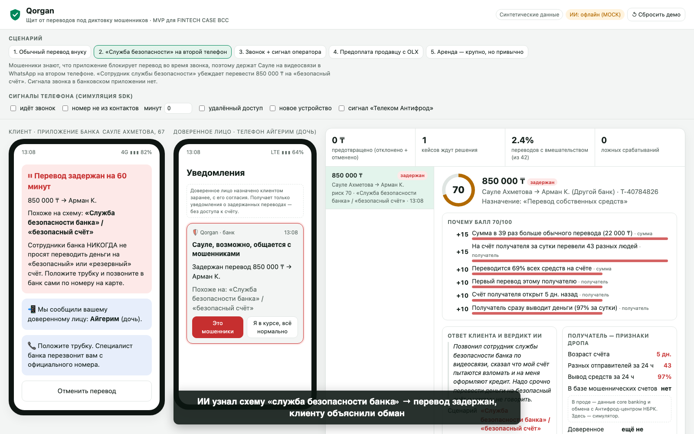
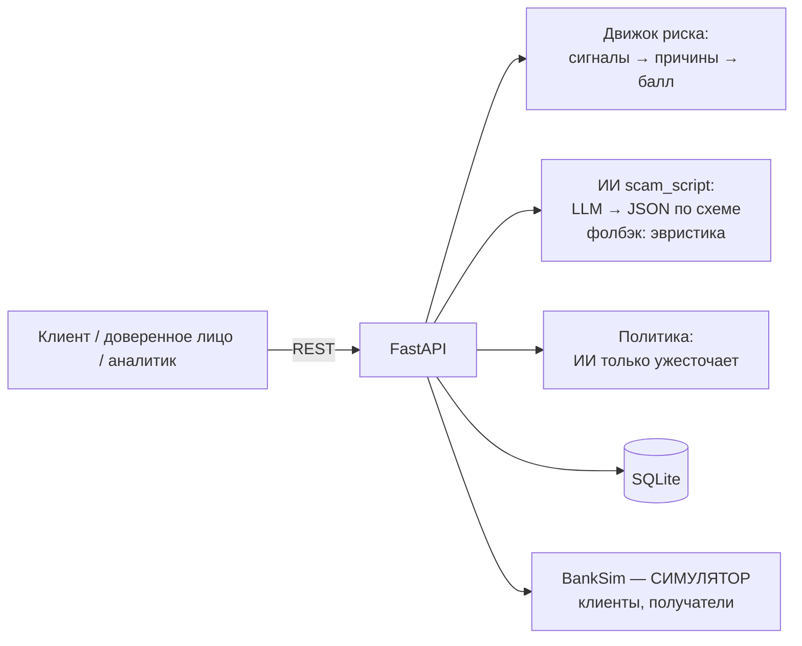

# Qorgan — щит от переводов под диктовку мошенников

**ITU HACKATHON-2026 · FINTECH CASE Банка ЦентрКредит «Инновации в банкинге и кибербезопасности»**

Qorgan («Қорған» — «защита») останавливает перевод, который клиент делает под диктовку мошенника. Честные переводы проходят без лишних вопросов. В момент перевода Qorgan:
1. считает объяснимый балл риска;
2. при высоком риске спрашивает клиента, зачем он переводит, и с помощью ИИ узнаёт схему обмана;
3. задерживает перевод и сразу подключает доверенное лицо и аналитика банка.



> Все данные синтетические. Это учебный MVP, а не продукт Банка ЦентрКредит. Что именно симулировано — в разделе [«Ограничения»](#ограничения).

## Запуск за 2 команды

Нужен Python 3.12+. Ключ API не нужен: без него ИИ работает в офлайн-режиме.

```bash
make install
```
```bash
make demo
```
Откройте http://localhost:8000. Для живого демо окно браузера должно быть не уже 1400 px: тогда клиент, доверенное лицо и аналитик видны на одном экране. Кнопка **«↺ Сбросить демо»** возвращает систему в исходное состояние.

Без `make`:
```bash
python3 -m venv .venv && .venv/bin/pip install -r requirements-dev.txt && .venv/bin/python -m uvicorn app.main:app --port 8000
```

Режим языковой модели (необязательно): `cp .env.example .env`, впишите `ANTHROPIC_API_KEY` (или OpenAI-совместимый провайдер), перезапустите. Бейдж в шапке сменится на «ИИ: LLM».

## Демо-сценарий (3 минуты)
1. **Обычный перевод внуку** 15 000 ₸ → проходит сразу, без трения.
2. **«Служба безопасности» на второй телефон** → сигнала звонка нет, но балл 70/100: сумма в 39 раз больше обычной, новый получатель, 43 отправителя за сутки → вопрос «зачем переводите?» → ИИ узнаёт схему → перевод задержан.
3. Телефон дочери: уведомление → «Это мошенники».
4. Консоль аналитика: причины балла, ответ клиента и вердикт ИИ, профиль получателя-дропа → «Отклонить и заблокировать получателя» → «предотвращено 850 000 ₸».

Пошагово с таймингом — [`docs/submission/DEMO_SCRIPT.md`](docs/submission/DEMO_SCRIPT.md). Видео-резерв — [`docs/media/qorgan_demo.mp4`](docs/media/qorgan_demo.mp4).

## Кейс → решение

| Направление кейса (цитата) | Как закрыто в Qorgan | Где в коде |
|---|---|---|
| «антифрод и выявление мошеннических операций» | балл риска 0–100 с причинами, 4 уровня вмешательства, задержка | `app/qorgan/risk.py`, `app/qorgan/policy.py` |
| «защиту клиентов и финансовых данных» | объяснение схемы клиенту; доверенное лицо получает сигнал без доступа к счёту | `app/qorgan/service.py`, `app/static/app.html` |
| «повышение безопасности финансовых операций» | ИИ разбирает ответ клиента (RU/KZ); ИИ может только ужесточить решение | `app/tasks/scam_script.py` |
| «новые цифровые сервисы и технологии для банка» | консоль аналитика с объяснимыми кейсами и метриками; REST API для встраивания | `app/qorgan/api.py`, `/docs` |

Полный текст кейса и правил — [`docs/CASE.md`](docs/CASE.md). Соответствие критериям жюри — [`docs/submission/CRITERIA_MAP.md`](docs/submission/CRITERIA_MAP.md).

## Как это работает



- **Балл риска** складывается из именованных причин: звонок, удалённый доступ, сигнал «Телеком Антифрод», сумма относительно привычек клиента, доля остатка, новый получатель, возраст счёта получателя, число отправителей за 24 ч, мгновенный вывод, история переводов. Веса и пороги — [`docs/RISK_MODEL.md`](docs/RISK_MODEL.md).
- **Уровни:** 0–29 — пропустить; 30–54 — предупредить; 55+ — проверочный диалог. Задержка — если ИИ узнал сценарий с уверенностью ≥ 0,6 или балл ≥ 80.
- **ИИ-задача `scam_script`** распознаёт 7 сценариев: служба безопасности, полиция/КНБ, родственник в беде, инвестиции, предоплата, выигрыш/работа, давление без сценария. Ответ строго по JSON-схеме. Ретраи, таймаут, кэш. При сбое — эвристика (`source: fallback`).
- **Инвариант:** выпустить задержанный перевод может только аналитик. Если модель «оправдала» текст с явными признаками схемы, правила перекрывают её (защита от prompt injection).

API с описанием: http://localhost:8000/docs.

## Качество

| Проверка | Результат |
|---|---|
| Автотесты (`make test`) | 71 проходит: движок риска, инварианты политики, переходы статусов, ошибки 404/409/422, метрики, сброс демо, ИИ-задача |
| Линтер и типы (`make lint`, `make typecheck`) | ruff и mypy --strict без ошибок |
| ИИ, офлайн-эвристика (`make eval TASK=scam_script DATASET=evals/datasets/scam_script.jsonl`) | 63 ответа RU/KZ: accuracy **0,841**, macro-F1 **0,846**, ложные срабатывания на честных ответах **15%** |
| ИИ, режим LLM | не измерен: нужен ключ. Та же команда с ключом в `.env` даёт отчёт в `evals/reports/` |
| Сквозной сценарий в браузере | пройден вручную и автоматически (`scripts/record_demo.py`, Playwright) |

Датасет составлен командой (синтетика), разметка ручная. В нём есть трудные отрицательные примеры («сыну на учёбу») и перефразировки без ключевых слов. Эвристика ошибается в основном на перефразировках — поэтому в боевом режиме нужна языковая модель.

## Ограничения
- **Данные синтетические:** клиенты, счета, получатели и 40 переводов демо-истории (`app/qorgan/bank_sim.py`, помечены `synthetic_history`).
- **Сигналы телефона** (звонок, удалённый доступ, новое устройство, «Телеком Антифрод») задаются галочками в демо-панели. В проде — SDK приложения и интеграция с пилотом НБРК.
- **Уведомление доверенному лицу и передача в Антифрод-центр** записываются в систему, но никуда не отправляются.
- **Веса риска экспертные**, не обучены на данных банка. Калибровка — первый шаг пилота.
- Веб-демо вместо мобильного приложения. Нагрузочного тестирования не было.
- Часть фактов о регулировании известна из СМИ, а не из текста нормативных актов. Это помечено в [`docs/research/RESEARCH.md`](docs/research/RESEARCH.md).

## Материалы для жюри
| Материал | Файл |
|---|---|
| Описание проекта для заявки | [`docs/submission/DESCRIPTION.md`](docs/submission/DESCRIPTION.md) |
| Презентация (редактируемая) | [`docs/submission/Qorgan_pitch.pptx`](docs/submission/Qorgan_pitch.pptx) — пересборка: `make deck` |
| Текст выступления, 5:00 | [`docs/submission/SPEECH.md`](docs/submission/SPEECH.md) |
| Сценарий демо, 3:00, и действия при сбоях | [`docs/submission/DEMO_SCRIPT.md`](docs/submission/DEMO_SCRIPT.md) |
| План без интернета | [`docs/submission/OFFLINE_PLAN.md`](docs/submission/OFFLINE_PLAN.md) |
| 15 вопросов жюри | [`docs/submission/JURY_QA.md`](docs/submission/JURY_QA.md) |
| Интеграция с банком и план до пилота | [`docs/submission/INTEGRATION.md`](docs/submission/INTEGRATION.md) |
| Экономика: формулы и допущения | [`docs/submission/ECONOMICS.md`](docs/submission/ECONOMICS.md) |
| Соответствие критериям | [`docs/submission/CRITERIA_MAP.md`](docs/submission/CRITERIA_MAP.md) |
| Исследование: статистика, регулирование, аналоги | [`docs/research/RESEARCH.md`](docs/research/RESEARCH.md) |
| Выбор идеи (5 концептов) и SPEC | [`docs/IDEAS.md`](docs/IDEAS.md), [`docs/SPEC.md`](docs/SPEC.md) |

## Структура
```
app/qorgan/        движок риска, политика, жизненный цикл перевода, API, хранилище, симулятор банка
app/tasks/         ИИ-задача scam_script (LLM + эвристика)
app/llm/           слой LLM: структурированный JSON, ретраи, кэш, mock-режим
app/static/app.html  интерфейс: клиент, доверенное лицо, аналитик
evals/             датасет и прогон оценки качества ИИ
scripts/           запись демо-видео, сборка презентации
tests/             автотесты
```

Проект собран на основе открытого стартового шаблона команды (`chore: scaffold from team starter template`). Вся логика Qorgan написана в рамках хакатона.
