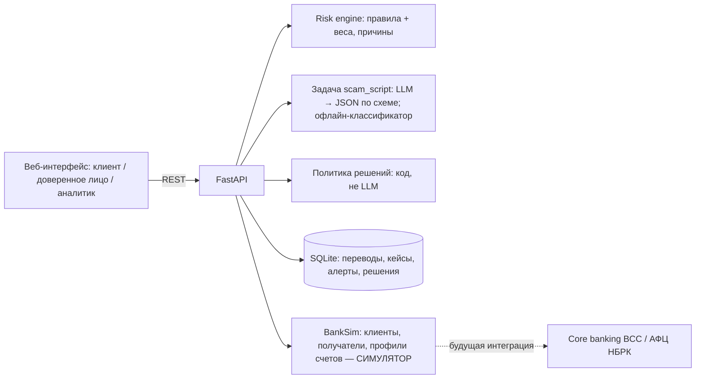

# Qorgan — SPEC
**Кейс:** FINTECH CASE Банка ЦентрКредит «Инновации в банкинге и кибербезопасности».
**Одной фразой:** Qorgan («Қорған» — «защита») останавливает перевод, который клиент делает под диктовку мошенника. Обычные переводы при этом проходят без лишних вопросов.

## Plan-note
- **Идея:** в момент перевода движок риска собирает сигналы: сессия (идёт звонок, новый получатель, необычная сумма, удалённый доступ), профиль клиента, риск получателя (признаки дропа). Затем он выбирает **уровень вмешательства**: пропустить, предупредить, проверочный диалог, задержать с участием доверенного лица. В проверочном диалоге клиент своими словами объясняет цель перевода. ИИ-модуль узнаёт в ответе сценарий обмана («служба безопасности», «полиция», «родственник в беде», «предоплата на маркетплейсе», «инвестиции»). Каждое решение объяснимо и попадает аналитику банка.
- **Плюсы:** закрывает три пункта кейса; ценность видна за 30 секунд; демо воспроизводимо офлайн; решения объяснимы.
- **Минусы и риски:** часть сигналов в проде зависит от ОС и обмена данными с АФЦ НБРК. Веса правил не откалиброваны на реальных данных.

## Проблема спонсора
Цифры с источниками — в `docs/research/RESEARCH.md`. Суть: основной ущерб клиентам — переводы, которые клиент делает **сам** под давлением мошенника. Классический антифрод их пропускает: вход и подтверждение настоящие.

## Решение — что видит каждый пользователь
- **Клиент** (экран приложения банка): перевод. Если риск высокий — понятное предупреждение со сценарием обмана простыми словами, вопрос «зачем переводите», задержка перевода и связь с доверенным лицом.
- **Доверенное лицо** (сын или дочь): push-уведомление «Маме, возможно, звонят мошенники» с кнопками «Это мошенники» / «Я в курсе, всё нормально».
- **Аналитик антифрода**: очередь кейсов с баллом риска, расшифровкой причин, ответом клиента и вердиктом ИИ, профилем получателя. Действия: освободить перевод, отклонить и заблокировать получателя, отметить ложное срабатывание. Метрики считаются по реальным действиям в системе.

## Демо-сценарий (3 минуты, подробно — `docs/submission/DEMO_SCRIPT.md`)
1. Сауле переводит 15 000 ₸ внуку (привычный получатель) → проходит мгновенно, без трения.
2. Сценарий «Служба безопасности» на второй телефон: в приложении звонка нет, Сауле переводит 850 000 ₸ новому получателю → балл 75 (сумма ×39, получатель похож на дроп) → проверочный диалог → «звонил сотрудник службы безопасности, сказал перевести на безопасный счёт» → ИИ: `fake_bank_security` → перевод задержан, доверенное лицо уведомлено. Если бы она ответила «маме на лекарства», перевод на дроп всё равно ждал бы специалиста.
3. Экран доверенного лица: «Это мошенники».
4. Экран аналитика: кейс с объяснением; получатель — дроп-риск (счёт открыт 5 дней назад, 40+ отправителей за 24 ч) → «Отклонить и заблокировать получателя» → метрика «предотвращено ₸» растёт.

## Скоуп
- **MUST:** движок риска с причинами; 4 уровня вмешательства; проверочный диалог; ИИ-задача `scam_script` (LLM + офлайн-классификатор); доверенное лицо; консоль аналитика; метрики из БД; SQLite; сброс демо; симулятор банка с явной маркировкой; тесты; evals.
- **SHOULD:** казахский язык в распознавании ответов; адаптивная вёрстка; переключение сценариев в демо-панели.
- **COULD:** экспорт кейса в JSON-формате для АФЦ.
- **WON'T:** реальная интеграция с банком, реальная биометрия, мобильное приложение, обучение ML-модели на выдуманных метках.

## Архитектура

- `app/qorgan/bank_sim.py` — синтетические клиенты и получатели. Явно помечен как симулятор, контракт `RecipientProfile` = точка интеграции с АФЦ.
- `app/qorgan/risk.py` — чистая функция `assess(transfer, session, client, recipient) -> RiskAssessment`.
- `app/tasks/scam_script.py` — ИИ-задача шаблона: структурированный ответ, эвристика как фолбэк, `postprocess` не даёт модели решать судьбу денег.
- `app/qorgan/policy.py` — итоговое решение = f(балл, вердикт ИИ). Вычисляется кодом.
- `app/qorgan/store.py` — SQLite.
- `app/qorgan/api.py` — REST-эндпоинты; `app/static/` — интерфейс.

## AI-часть
- **Зачем ИИ:** клиент описывает ситуацию свободным текстом, на русском или казахском, с ошибками, часто пересказывая слова мошенника. Правила по ключевым словам ловят только очевидное. Модель должна узнать сценарий по смыслу.
- **Модель:** через env (`LLM_MODEL`); по умолчанию из шаблона. Без ключа работает mock-режим на эвристике, демо от API не зависит.
- **Гардрейлы:** ответ строго по JSON-схеме; текст клиента — это данные, а не инструкции; ИИ не может «одобрить» перевод: он только добавляет риск, а снижает риск только человек (аналитик или доверенное лицо).
- **Качество:** `evals/datasets/scam_script.jsonl` (синтетический датасет, размечен вручную) → accuracy, macro-F1, recall по мошенническим сценариям, доля ложных срабатываний.

## Стоимость и масштаб
Модель вызывается только в проверочном диалоге, то есть для малой доли переводов. Расчёт с формулами — `docs/submission/ECONOMICS.md`.

## Риски и план Б
- LLM недоступна → офлайн-классификатор (`source: fallback`); демо проходит офлайн.
- Нет интернета на защите → всё работает локально, ключ не нужен (`docs/submission/OFFLINE_PLAN.md`).
