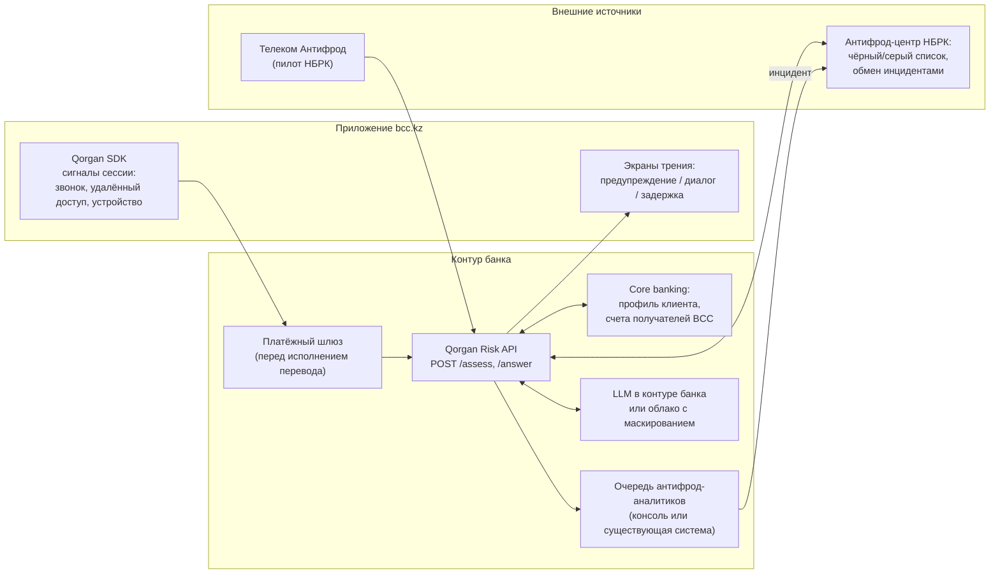

# Интеграция с банком и путь от MVP к пилоту

## Схема интеграции

## Точки интеграции (что в MVP симулировано)

| Контракт в коде | Что делает | В MVP | В пилоте |
|---|---|---|---|
| `SessionSignals` (`app/qorgan/bank_sim.py`) | сигналы телефона во время перевода | галочки в демо-панели | SDK приложения; часть сигналов уже собирается по требованиям АРРФР (по данным СМИ) |
| `SessionSignals.telecom_fraud_flag` | сигнал оператора о мошенническом звонке | галочка | интеграция с пилотом НБРК «Телеком Антифрод» |
| `ClientProfile` | средний и максимальный перевод, остаток, доверенное лицо | синтетика | core banking / CRM |
| `RecipientProfile` | возраст счёта, отправители за 24 ч, вывод средств, чёрный список | синтетика | счета BCC — из core banking; счета других банков и списки — через АФЦ НБРК |
| `POST /api/transfers` | оценка перевода до исполнения | реализовано | вызов из платёжного шлюза, таймаут ≤ 300 мс, при недоступности — текущие правила банка (fail-open на старые правила, без потери защиты) |
| `POST /api/transfers/{id}/answer` | проверочный диалог | реализовано, LLM или офлайн-классификатор | LLM в контуре банка или облако с маскированием персональных данных |
| `/api/cases`, `/api/cases/{id}/decision` | очередь и решения аналитика | консоль Qorgan | интеграция в существующую систему кейсов банка |
| уведомление доверенному лицу | push «возможно, мошенники» | запись в БД + экран | push / SMS-шлюз банка |
| передача инцидента в АФЦ | после «Отклонить» | запись в хронологии (симуляция) | API обмена АФЦ |

**Почему это встраивается.** Qorgan — это не отдельное приложение для клиента, а модуль с REST API и OpenAPI-описанием (`/docs`). Его можно вызвать из существующего платёжного потока и подключить к существующей очереди кейсов.

## Безопасность и данные
- Ответ клиента — персональные данные. В пилоте нужна модель в контуре банка или маскирование ФИО, номеров и счетов перед отправкой во внешнюю модель. Нужна проверка по Закону РК «О персональных данных и их защите».
- Текст клиента обрабатывается как данные, а не инструкции. Попытка «уговорить» модель в тексте перекрывается правилами (`postprocess`, тест `test_prompt_injection_cannot_whitewash_a_scam`).
- Решение о деньгах принимает код политики, а не модель. Снять задержку может только человек.
- Доверенное лицо получает только факт задержки и сценарий. Доступа к счёту у него нет. Назначается заранее, с согласия клиента.

## План: MVP → пилот

| Этап | Срок (цель) | Что делаем | Критерий успеха |
|---|---|---|---|
| 0. MVP (сейчас) | ноябрь 2026 | сквозной сценарий, синтетические данные, тесты, evals | демо без сбоев, все кейс-требования закрыты |
| 1. Офлайн-проверка на данных банка | 1–2 месяца | прогон модели риска по обезличенной истории инцидентов BCC и АФЦ; калибровка весов; размеченный датасет ответов клиентов | известны recall и доля ложных срабатываний на реальных данных |
| 2. Теневой режим | 1 месяц | Qorgan оценивает живые переводы, но не вмешивается; аналитики сверяют кейсы | precision задержек ≥ 70% (цель) |
| 3. Пилот на сегменте | 2–3 месяца | трение включено для 5–10% клиентов (например, 60+ или по согласию) с A/B-контролем | снижение потерь в пилотной группе против контрольной; friction_rate ≤ 1% (цель) |
| 4. Масштаб | далее | все клиенты, BCC Business, обмен кейсами с АФЦ, обучение ML-модели на накопленных метках | — |

## Масштабируемость
- Оценка риска — чистая функция без состояния: масштабируется горизонтально. В демо-БД SQLite, в проде — PostgreSQL или хранилище кейсов банка.
- ИИ вызывается только в проверочном диалоге, у малой доли переводов (см. `ECONOMICS.md`).
- Новые сценарии мошенничества добавляются как категория в схеме ответа ИИ и в датасете evals, без переписывания движка.
